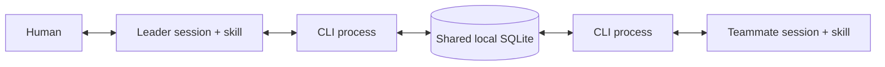

# Architecture

The skill tells an agent when and how to call the CLI. It is not a transport or background worker. CLI processes coordinate through one local file. A plugin packages the executable, core, and skills; both installed copies must point to the same database. No message leaves the machine through this CLI.

## Tables and boundaries

| Table | Identity | Purpose |
|---|---|---|
| runs | id | Independent top-level task/team |
| agents | id | Session address; client is informational |
| memberships | run_id, agent_id | Role and leader within one run |
| threads | run_id, id | Conversation within one run |
| messages | run_id, id | Addressed body, reply link, delivery state and lease |

Each run has one leader. An agent can belong to multiple runs; every command explicitly selects a run and session. Composite foreign keys keep recipients, senders, threads, and reply parents within the run. A reply stays within its parent's thread and goes to its sender. Addresses are logical routing in a trusted local environment, not authentication.

A message progresses from pending to leased to acked. An expired leased message becomes available again without requiring a cleanup process. Claim reserves delivery atomically, increments attempts, and generates a fresh token. Ack accepts only the current unexpired token; repeating an already accepted token remains successful. A send key is unique per run and sender; a retry with the same request returns the original message.

WAL permits concurrent readers with a writer. Writes still serialize; transactions are short and use a bounded busy timeout. Polling never holds a transaction between checks. SQL parameters are bound by the core. The CLI returns machine-readable JSON; agents do not write SQL.

## Tasks outlive sessions

The original task message is a stable reference. A session ID changes when an agent is replaced. A teammate records periodic versioned checkpoints in an allowed artifact location, with current decisions, completed work, next action, tests, code state, dead ends, and blockers. It sends the checkpoint path and version to its leader.

When replacing a teammate, the leader stops the old work, starts the successor through an available launcher or user action, and addresses a new task message to that session with `send --thread ORIGINAL_THREAD_ID`, referencing the original task and checkpoint version in its body. Startup `task_message_id` identifies this new assignment to claim/reply to; `original_task_message_id` preserves traceability. The old task may already be acked and addressed to another session, so the successor does not claim it. The successor receives those references in its first prompt. It does not inherit the old inbox or context. Self-addressed messages are notes for their addressed session; they do not migrate a task. No separate handoff document or skill is needed.

An ack records message acceptance, not task completion. A result is a separate message. A crash after ack requires leader-coordinated task recovery. There is no task-wide ownership lock and no exactly-once guarantee for external actions. The leader prevents old and new teammates from working simultaneously. Context capacity varies; skills keep checkpoints with headroom rather than promising an automatic 200K-token trigger.

## Scope

Supported: local Python CLI and skills for active Codex/Claude Code sessions. A leader or launcher must deliver the first startup prompt. Agents must check inbox or use bounded wait calls to receive new mail. A completed idle agent is not automatically awakened. Network filesystems, native cross-product team membership, agent launching, and host-specific context injection are outside this package.

Native packaging references: [OpenAI plugin packaging](https://developers.openai.com/plugins/build/plugins), [Claude plugin reference](https://code.claude.com/docs/en/plugins-reference), and [Claude marketplaces](https://code.claude.com/docs/en/plugin-marketplaces).
